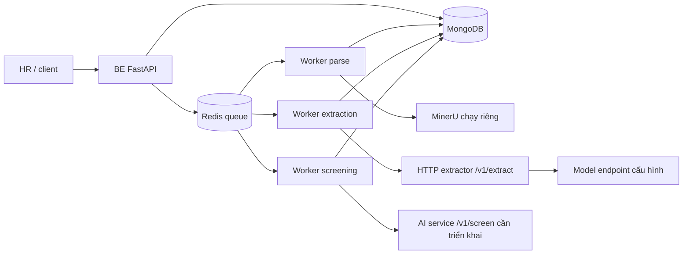

# Tổng hợp tính năng và API — Resume Screening System

Ngày rà soát: **2026-10-14**. Tài liệu phản ánh code trong working tree hiện tại,
bao gồm API MVP cho CV, model selection, revision hồ sơ HR và screening override. Đây là bản tra cứu tính năng và
endpoint; không phải tuyên bố đã nghiệm thu toàn bộ MVP với model/cloud thật.

Nguồn đối chiếu: router đăng ký tại [versions.py](../app/dependencies/versions.py),
[app.main](../app/main.py), [extractor](../app/extraction_service.py), cùng schema,
service, repository và policy được các handler sử dụng.

## 1. Phạm vi và cách đọc

- **BE chính** (`app.main:app`): 93 endpoint nghiệp vụ dưới prefix mặc định
  `/api/v1`, cộng 7 endpoint thông tin/health/monitoring ở root: **100 endpoint**.
- **Extractor riêng** (`app.extraction_service:app`): **3 endpoint khai báo trực
  tiếp**. Cùng đường dẫn `/live` hoặc `/ready` ở hai process là hai API riêng.
- Tổng cộng **103 cặp method/URL theo service** khai báo trực tiếp trong code.
  Các URL tài liệu OpenAPI được framework sinh tự động được ghi riêng bên dưới.
- Các URL `/api/v1/...` dùng mặc định `API_V1_STR=/api/v1`; nếu cấu hình prefix
  khác thì thay prefix tương ứng. Giữ dấu `/` cuối URL khi bảng có ghi.
- `Actor` là vai trò toàn hệ thống; `UserCompany` là membership/role tại chi
  nhánh. Hai loại quyền này có phạm vi khác nhau. `Administrator` không mặc
  nhiên có quyền ghi global RBAC như superuser hoặc bỏ kiểm tra tenant/branch.
- Cột input ghi các dữ liệu chính, không thay thế toàn bộ danh sách field/ràng
  buộc trong schema. Cột status ghi kết quả thành công thông thường; lỗi vẫn
  có thể là 400/401/403/404/409/422/429 hoặc lỗi dependency tùy handler.
- Phạm vi dữ liệu được ghi theo hành vi service hiện tại. Không suy ra rằng
  mọi API có `company_id` đều kiểm tra branch, hoặc mọi API dùng cùng response.

## 2. Các tính năng hiện có

| Nhóm | Tính năng đã có trong code | Phạm vi / điều kiện chạy |
| --- | --- | --- |
| Đăng ký và đăng nhập | Đăng ký email/password, OTP qua email, gửi lại OTP, xác minh, login | Email sử dụng Brevo khi cấu hình; có giới hạn tần suất và validation |
| Phiên đăng nhập | Access JWT, refresh cookie HttpOnly, CSRF refresh/logout, rotation, phát hiện reuse, revoke session, `auth_version` | Session bền vững trong Mongo; Redis hỗ trợ revocation/rate limit theo policy; business API kiểm tra access token/session/user active |
| Người dùng | Tạo/đọc/sửa, deactivate, hard delete có điều kiện, cập nhật/deactivate hàng loạt, xác minh thủ công, đổi/reset password, thống kê và xóa cache user | Quyền từng endpoint khác nhau; bảo vệ superuser và field nội bộ; xem các giới hạn ở nhóm user |
| RBAC toàn hệ thống | CRUD actor/permission, gán/gỡ permission cho actor, gán/gỡ actor cho user | Ghi global RBAC yêu cầu superuser còn active theo kiểm tra DB; quyền đọc theo dependency hiện có |
| Company và branch | Tạo/danh sách/chi tiết/cập nhật một phần/vô hiệu company; tạo/danh sách/chi tiết branch | Company response có ID/state/timestamps; quyền đọc từ DB active/expiry; member chỉ branch được phép; chưa có branch sửa/xóa |
| Membership | Gán/gỡ user vào branch, xem assignment, danh sách user/branch, đổi role và thống kê membership | Có policy role/ownership/active/expiry trong service; phạm vi kiểm tra cụ thể khác nhau giữa API legacy và API tenant mới |
| Ứng viên | Tạo, danh sách, đọc chi tiết, cập nhật thông tin liên hệ/tags/metadata | Gắn với company; candidate và profile CV trích xuất là hai loại dữ liệu riêng |
| Yêu cầu tuyển dụng | Tạo, tìm kiếm/lọc, danh sách, chi tiết, cập nhật, xóa, export | Search job và API quản lý job có scope khác nhau; export và dependency được ghi trong bảng API |
| Đơn ứng tuyển | Tạo application gắn candidate/CV/job, phân trang, chi tiết, chuyển stage | Có idempotency, revision/CAS và lưu stage event; chưa có endpoint đọc riêng timeline stage event |
| Scorecard | Tạo phiên bản tiêu chí, trọng số, tiêu chí bắt buộc, minimum score và ngưỡng đạt; đọc bản active | Tổng trọng số xấp xỉ 1, code tiêu chí không trùng; screening giữ snapshot scorecard |
| CV | PDF/DOCX, upload/list/detail/download, metadata/checksum, kiểm MIME/chữ ký file, giới hạn kích thước và cấu trúc DOCX | Mặc định tối đa 5 MiB; scope company/branch/Candidate sở hữu; download local kiểm path/file/hash; chưa có delete/restore |
| Parsing | Worker đọc file, phân tích PDF/DOCX, nhận biết scan, OCR/tier fallback MinerU, native text fallback, quality gate và lịch sử provider attempt | Có code worker/adapter; MinerU chạy riêng, cần endpoint cấu hình; poll parse run để xem provider/OCR/quality/lỗi |
| Extraction | Worker và HTTP extractor trích xuất thông tin cá nhân, summary, skills, experience, education, certifications, languages | Có schema v1, bằng chứng nguyên văn/Unicode offsets, trạng thái thiếu/mâu thuẫn, version profile và metadata truy nguồn; cần model endpoint phù hợp |
| Screening | API tạo/poll run, snapshot source/profile/scorecard/model/prompt, adapter HTTP gọi AI service, kiểm response binding và dẫn chứng, lưu result | BE đã có adapter; server AI nhận `/v1/screen` chưa được triển khai trong repository |
| Tính điểm | BE tính điểm theo trọng số, coverage, khoảng điểm, pass/fail/hold; tiêu chí chưa đánh giá giữ `null` | Có tiêu chí thiếu/mâu thuẫn thì `overall_score=null`, `decision=hold`; không dùng tổng điểm do AI trả làm kết quả chính thức |
| HR review | Nhận xét theo vòng; sửa hồ sơ bằng revision có dẫn chứng/xác nhận HR riêng; override screening kèm lý do/version/history/effective assessment | Bản AI gốc giữ nguyên; kiểm source current/latest result và CAS; review độc lập chưa có API sửa/xóa |
| Chọn model screening | List model active `scoring/skill_matcher` để lấy ID khi tạo run | Chỉ metadata công khai, không config/credentials; chưa có CRUD model |
| Worker / queue | Redis Stream cho parse/extraction/screening; claim, heartbeat, lease/generation, retry/backoff, recovery và publish sau commit | Mongo là nguồn trạng thái chính; worker yêu cầu Mongo replica set và Redis; client poll run để theo dõi |
| Hạ tầng dùng chung | Transaction, index/migration/bootstrap, cache TTL/invalidation, rate limit, giới hạn body/upload, lifecycle quản lý task và retention audit | Có code và regression; API audit chỉ ghi ở các điểm đã tích hợp, không có router tra cứu audit log riêng |
| Vận hành | Root info, liveness/readiness, debug config, process/system metrics và Prometheus text | Readiness chính kiểm DB/Redis/storage; metrics yêu cầu admin; cấu hình debug và auto docs phụ thuộc `DEBUG` |
| Docker / local | API, Mongo replica set, Redis; profile parse/extraction/screening; Compose dev và launcher local | Extractor có container tùy chọn; MinerU và scorer cần cung cấp riêng; frontend chưa có trong repository |

### Luồng xử lý chính

Parsing tạo văn bản nguồn; extraction tạo hồ sơ có dẫn chứng; screening đánh
giá hồ sơ theo scorecard. Các bước dùng run và queue riêng. Upload không tự
đồng nghĩa đã parse/extract/screen xong. HTTP 202 chỉ xác nhận đã nhận lệnh.

## 3. Quy ước khi gọi API

**Xác thực business API:** gửi `Authorization: Bearer <access_token>`.
Token refresh được gửi bằng cookie; với trình duyệt cần `credentials: "include"`.
Refresh/logout cần cả cookie CSRF và header `X-CSRF-Token` tương ứng. Tên
cookie/header có thể thay bằng cấu hình; mặc định refresh là `refresh_token`,
CSRF là `csrf_token`. Cookie production yêu cầu Secure; HTTPS cần thiết để
trình duyệt gửi cookie Secure. Kiểm tra `REFRESH_COOKIE_SAMESITE` trong cấu hình
thực tế, không suy ra giá trị chỉ từ môi trường.

**Idempotency:** các API tạo application, đổi stage, tạo scorecard, tạo screening,
parse, extraction, HR profile revision và screening override dùng `Idempotency-Key` dài 8–128 ký tự. Khi retry cùng lệnh,
giữ key gốc. Scope/replay cụ thể theo service; key của HTTP screening nội bộ là
run ID, khác key command client gửi vào BE.

**Response:** nhiều handler trả `ApiResponse[T]` với `success`, `data`, `message`.
Một số endpoint trả model/list/dict trực tiếp hoặc 204 không body. Bảng dưới
ghi khác biệt; không viết frontend giả định mọi response đều có `.data`.
Upload dùng `multipart/form-data`; đa số lệnh khác dùng JSON, một số endpoint
RBAC dùng query params. Lỗi validation/schema có thể trả 422 trước nghiệp vụ.

**Quyền và dữ liệu:** permission trong bảng là tên dùng bởi code; superuser có
policy riêng. Quyền lấy từ user/actor/permission đang hoạt động trong DB. Với
tenant, quyền công ty và role membership của branch không thay thế nhau; đọc
ghi phải tuân theo phạm vi cụ thể của endpoint và service.

## 4. Tài khoản, đăng nhập và phân quyền toàn hệ thống

Backend có đăng ký email/điện thoại, OTP xác minh, đăng nhập, refresh/logout theo session; quản lý user, đổi/quên mật khẩu, thống kê user; CRUD actor/permission và liên kết user–actor, actor–permission. Actor là role toàn hệ thống, khác membership company/branch. Các đường dẫn dưới đây dùng cấu hình mặc định `API_V1_STR=/api/v1`; prefix lấy từ `app/dependencies/versions.py`. Không có endpoint placeholder trong nhóm này.

API được bảo vệ nhận `Authorization: Bearer <access_token>`. `get_current_user` kiểm tra loại access, session `sid`, revocation, user active và `auth_version`, rồi nạp actor/permission đang active từ DB. `Administrator` là actor (`is_admin`); không đồng nghĩa `is_superuser`. Superuser có thể vượt kiểm tra permission, nhưng vẫn chịu những chốt bảo vệ target ở service/repository. Trong bảng, `ApiResponse<T>` là `{success, data, message}`; các response ghi “JSON trực tiếp” hoặc DTO trực tiếp không có envelope này. Schema sai có thể trả 422; endpoint có rate limit có thể trả 429; API bảo vệ có thể trả 401/403.

### Đăng ký, OTP và session — 6 endpoint

Login và refresh trả `AccessToken` trong JSON (`access_token`, `token_type`, `expires_in`, `user`); verify OTP trả object này trong `data.token`. Refresh token chỉ được đặt vào cookie `refresh_token` HttpOnly. Cookie `csrf_token` cho phép frontend đọc và giá trị CSRF cũng được trả trong header `X-CSRF-Token`; response có `Cache-Control: no-store`. Tên cookie/header có thể đổi bằng cấu hình. Production yêu cầu refresh cookie Secure; SameSite mặc định `lax`, code hiện cho phép cấu hình `strict` hoặc `none` khi có Secure. Refresh/logout cần gửi cả hai cookie và header CSRF trùng cookie, không nhận refresh token từ JSON. Session được lưu trong Mongo, refresh rotation dùng một lần, reuse revoke session; logout làm access token cùng session mất hiệu lực. Email được gửi bằng background task qua Brevo, nên HTTP thành công chưa chứng minh email đã đến hộp thư.

| Method và đường dẫn đầy đủ | Chức năng thực tế | Input/header quan trọng | Output và status | Xác thực/policy |
| --- | --- | --- | --- | --- |
| `POST /api/v1/register/register` | Tạo user inactive, unverified, gán actor Candidate mặc định và chuẩn bị OTP đăng ký | JSON `RegisterRequest`: `email`, `password`, `phone_number`; `full_name`, `address` optional; email chuẩn hóa lowercase, số điện thoại chuẩn hóa | 201 `ApiResponse<UserResponse>`; 400 email/điện thoại trùng hoặc password yếu; 503 nếu actor mặc định chưa được bootstrap | Public; 3/minute; không cho request đặt role/superuser; OTP gửi background |
| `POST /api/v1/register/verify-otp` | Consume OTP đăng ký một lần, xác minh và activate user, tạo session đăng nhập | JSON `email`, `otp` gồm 6 chữ số | 200 `ApiResponse<VerifyOTPResponse>` với `success`, `token: AccessToken`, `user`; đặt refresh/CSRF cookie; 400 OTP sai/hết hạn/hết lượt/đã dùng | Public; 5/minute; kiểm tra OTP hash, thời hạn và số lần thử |
| `POST /api/v1/register/resend-otp` | Tạo/thay OTP đăng ký, đặt lại số lần thử và gửi email | JSON `{email}` | 200 `ApiResponse<{message,email,expires_in_minutes}>`; 404 user thiếu; 400 đã verify; 429 gửi lại quá sớm | Public; 3/minute; cooldown service 30 giây khi còn OTP chưa dùng |
| `POST /api/v1/register/login` | Xác thực email/password và tạo session | JSON `{email,password}` | 200 `ApiResponse<AccessToken>` và refresh/CSRF cookie; 401 sai credentials; 403 inactive/chưa verify | Public; 5/minute; actor/permission lấy từ DB, JWT scope không là nguồn quyết định quyền |
| `POST /api/v1/register/logout` | Revoke session trong refresh cookie và xóa hai cookie | Cookie refresh + CSRF; header `X-CSRF-Token`; Bearer access optional, không thay thế cookie/CSRF | 200 `ApiResponse<{message}>`; 401 refresh sai/thiếu, 403 CSRF sai; 503 nếu không revoke được | Không dùng dependency access token; cần refresh session hợp lệ và CSRF; 10/minute |
| `POST /api/v1/register/refresh` | Rotate refresh token cùng session, tạo access token/CSRF mới, giữ thời hạn tuyệt đối session | Cookie refresh + CSRF; header `X-CSRF-Token`; không cần JSON body | 200 `ApiResponse<AccessToken>` và cookie mới; 401 session hết hạn/revoked/reuse, 403 CSRF; lỗi revocation có thể 503 | Refresh session + CSRF; 10/minute; refresh token không dùng được cho business API |

### Quản lý user và mật khẩu — 17 endpoint

`UserResponse` chỉ công bố ID, email, tên, điện thoại, địa chỉ, trạng thái active/verified, thời gian tạo và message; không chứa password hash. Schema mật khẩu mới yêu cầu độ dài cấu hình (mặc định tối thiểu 8 ký tự, tối đa 72 byte UTF-8), có chữ hoa/chữ thường; đăng ký còn qua `password_strength_check`. Cập nhật user dùng allowlist field. User thường chỉ sửa thông tin bản thân; Administrator/superuser có policy rộng hơn. Chỉ superuser được đặt `is_superuser`; `role` bị từ chối và phải dùng API user–actor. Không demote/deactivate/xóa superuser qua các CRUD thông thường, không tự deactivate/xóa qua API quản trị. Đổi mật khẩu, reset mật khẩu và đổi trạng thái active cập nhật `auth_version`, làm token cũ mất hiệu lực.

| Method và đường dẫn đầy đủ | Chức năng thực tế | Input/header quan trọng | Output và status | Xác thực/policy |
| --- | --- | --- | --- | --- |
| `POST /api/v1/users/` | Tạo user bằng CRUD, mặc định inactive và unverified; không gửi OTP hoặc gán actor | JSON `UserCreate`: `email`, `password`; optional `full_name`, `phone_number`, `address`; phone nếu có chỉ chữ số | 201 `ApiResponse<UserResponse>`; 400 email/phone trùng | Bearer + `users:create`; 10/minute; request không tạo superuser |
| `GET /api/v1/users/` | Liệt kê user active, phân trang và sort | Query `page>=1`, `size=1..100`, `email`, `full_name`, `phone`, `is_verified`, `role`; `sort_by=email/username/full_name/created_at/last_login`, `sort_desc` | 200 `ApiResponse<UserResponse[]>`; không trả `total/page/size` trong response | Bearer + **superuser**, không chỉ `users:view`; rate limit đọc |
| `GET /api/v1/users/search/` | Tìm user active theo email/username/full name/phone, sort created_at giảm dần | Query `q` 2..100 ký tự, `skip>=0`, `limit=1..100` | 200 mảng `UserResponse[]` trực tiếp, không envelope/pagination metadata | Bearer + **superuser** |
| `GET /api/v1/users/me` | Đọc hồ sơ user đang đăng nhập | Bearer; không cần user ID | 200 `UserResponse` trực tiếp; 404 nếu user không còn tồn tại | Bearer hợp lệ; không cần permission cụ thể |
| `GET /api/v1/users/{user_id}` | Đọc user theo ID | Path `user_id` Mongo ObjectId | 200 `ApiResponse<UserResponse>`; 404 thiếu user | Bearer + **superuser** tại router; service không mở thêm quyền cho caller thường |
| `PUT /api/v1/users/{user_id}` | Sửa hồ sơ/trạng thái theo policy dùng chung single/bulk | JSON `UserUpdate`: optional `full_name`, `phone_number`, `address`, `is_active`, `is_verified`, `is_superuser`, `role`; field lạ bị từ chối | 200 `ApiResponse<UserResponse>`; 403 sai target/field; 400 `role` hoặc flag null không hợp lệ; 404 thiếu target | Bearer; service chỉ cho chính mình hoặc Administrator/superuser; tự sửa flags bị chặn, role không được ghi trực tiếp |
| `DELETE /api/v1/users/{user_id}` | Soft-delete/deactivate user, ghi dấu xóa và invalidation | Path `user_id` | 204 không body; 403 target superuser/bản thân; 404 thiếu target | Bearer + `users:delete`; service/repository bảo vệ superuser và chống target đổi trạng thái khi ghi |
| `DELETE /api/v1/users/hard/{user_id}` | Xóa vĩnh viễn user đã inactive | Path `user_id` | 204 không body; 400 nếu target còn active; 403 superuser/bản thân; 404 thiếu target | Bearer + `users:delete`; repository yêu cầu inactive và không superuser |
| `POST /api/v1/users/bulk/update` | Bulk update user, prevalidate từng target và ghi trong transaction | JSON `{user_ids,update_data}`; 1..100 ID duy nhất và hợp lệ; `update_data: UserUpdate` | 200 JSON trực tiếp `{message,updated_count,total_count}`; 403/404 target bị cấm/thiếu; 422 list/schema sai | Bearer + `users:edit`; service còn yêu cầu Administrator/superuser, áp dụng cùng policy field/target như single update |
| `POST /api/v1/users/bulk/deactivate` | Bulk deactivate user, cập nhật auth version và dấu deactivation | JSON `{user_ids}`; 1..100 ID duy nhất | 200 JSON trực tiếp `{message,deactivated_count}`; 403/404 target bị cấm/thiếu | Bearer + `users:delete`; kiểm tra từng target, không superuser/bản thân; transaction cho nhóm ghi |
| `POST /api/v1/users/verify/{user_id}` | Đánh dấu email verified bằng thao tác quản trị; **không activate user** | Path `user_id`; không body | 200 JSON trực tiếp `{message}`; 404 nếu thiếu user, đã verified hoặc không phù hợp điều kiện verify | Bearer + **superuser**; khác verify OTP đăng ký có activate |
| `POST /api/v1/users/password/change` | Đổi mật khẩu của chính caller, consume state bằng CAS và vô hiệu token cũ | JSON `{current_password,new_password}` | 200 JSON trực tiếp `{message}`; 400 password hiện tại sai/thao tác không thành công | Bearer; không cần permission riêng; 5/minute; cần đăng nhập lại sau khi đổi |
| `POST /api/v1/users/password/reset/request` | Với user active, tạo reset token, lưu digest/thời hạn và gửi email background | JSON `{email}` | 200 JSON trực tiếp message chung, kể cả email không có/user inactive/lỗi tạo-gửi; không trả token | Public; 5/hour; token TTL 3600 giây; response không xác nhận account tồn tại |
| `POST /api/v1/users/password/reset/confirm` | Consume reset token một lần và đổi password/auth version | JSON `{token,new_password}`; token dài 32..200 ký tự | 200 JSON trực tiếp `{message}`; 400 token sai/hết hạn/đã consume | Public; 5/hour; phải có token còn hạn gắn với auth version hiện tại; sau reset cần login lại |
| `GET /api/v1/users/stats/overall` | Thống kê user từ DB: tổng, active, verified, superuser, signup 7 ngày, role counts | Không body | 200 `UserStatisticsResponse` trực tiếp, có `calculated_at` | Bearer + **superuser**; endpoint đã có query thống kê, không phải placeholder |
| `GET /api/v1/users/stats/activity/{user_id}` | Thông tin hoạt động/account age/login/verification của một user | Path `user_id` | 200 `UserActivityStatsResponse` trực tiếp; 404 khi repository trả lỗi/không tìm thấy | Bearer + **superuser**; dữ liệu tính từ document user, không phải event timeline đầy đủ |
| `POST /api/v1/users/cache/clear` | Xóa namespace cache user; không flush toàn Redis, không revoke session | Không body | 200 JSON trực tiếp `{message}`; Redis không sẵn sàng cũng có thể là no-op 200 | Bearer + `users:edit`; 5/minute |

Giới hạn contract hiện tại: schema `UserFilter` còn khai báo `is_active` và các mốc created/updated time, nhưng repository list chưa áp dụng các field này và luôn lọc `is_active=true`; filter `role` dùng field legacy trên user, không join user–actor. API list/search chưa trả tổng số bản ghi. Hai API DELETE user khai báo status 204 dù handler tạo `ApiResponse`; client nên xử lý như response không body.

### Actor (role toàn hệ thống) — 5 endpoint

Actor CRUD chỉ thao tác các actor active; delete là soft-delete. Ghi RBAC global cần superuser thực đang active: `CurrentUser.SUPERUSER_ONLY_PERMISSIONS` chặn việc chỉ gán permission write cho user thường, và `authorize_global_rbac_write` kiểm tra lại user trong DB ở service. Read có thể cấp bằng permission. Actor không tự tạo membership company/branch hoặc đổi `is_superuser`.

| Method và đường dẫn đầy đủ | Chức năng thực tế | Input/header quan trọng | Output và status | Xác thực/policy |
| --- | --- | --- | --- | --- |
| `POST /api/v1/actors/create-actor` | Tạo actor active | JSON `{name,description?}` | 200 `ApiResponse<ActorResponse>` (không phải 201); 400 tên active đã có | Bearer + `actors:create`, **thực tế superuser**; service recheck DB |
| `GET /api/v1/actors/list-actors` | Danh sách mọi actor active, không phân trang | Không body/query pagination | 200 `ApiResponse<ActorResponse[]>` | Bearer + `actors:view` |
| `PUT /api/v1/actors/update-actor/{actor_id}` | Đổi name/description của actor active, invalidate authorization cache | Path `actor_id`; JSON phải có hai key `name`, `description`, giá trị có thể null để giữ nguyên | 200 `ApiResponse<ActorResponse>`; 404 actor không active/thiếu | Bearer + `actors:edit`, **thực tế superuser**; service recheck DB |
| `GET /api/v1/actors/get-actor/{actor_id}` | Đọc actor active | Path `actor_id` | 200 `ApiResponse<ActorResponse>`; 404 actor không active/thiếu | Bearer + `actors:view` |
| `DELETE /api/v1/actors/delete-actor/{actor_id}` | Set actor inactive, invalidate authorization | Path `actor_id` | 200 `ApiResponse<{message}>`; 404 actor không active/thiếu | Bearer + `actors:delete`, **thực tế superuser**; service recheck DB |

### Permission — 5 endpoint

Permission là định danh quyền như `resume_profiles:view`. Ghi permission dùng cùng chốt superuser thực và recheck DB như actor; delete set inactive. Response `PermissionResponse` hiện chỉ có `id/name/description`, mặc dù một số handler truyền thêm `is_active` (không trở thành field public).

| Method và đường dẫn đầy đủ | Chức năng thực tế | Input/header quan trọng | Output và status | Xác thực/policy |
| --- | --- | --- | --- | --- |
| `POST /api/v1/permissions/create-permission` | Tạo permission active | JSON `{name,description}`, cả hai bắt buộc | 200 `ApiResponse<PermissionResponse>`; 400 tên active đã có | Bearer + `permissions:create`, **thực tế superuser**; service recheck DB |
| `GET /api/v1/permissions/permissions` | Phân trang các permission active | Query `page>=1`, `size=1..100` (default 10) | 200 `ApiResponse<PermissionListResponse>` có `permissions,total,page,size` | Bearer + `permissions:view` |
| `PUT /api/v1/permissions/update-permission/{permission_id}` | Đổi name/description, invalidate authorization | Path `permission_id`; JSON phải có `name`, `description`, mỗi field có thể null để giữ nguyên | 200 `ApiResponse<PermissionResponse>`; 404 thiếu/inactive | Bearer + `permissions:edit`, **thực tế superuser**; service recheck DB |
| `GET /api/v1/permissions/get-permission/{permission_id}` | Đọc một permission active | Path `permission_id` | 200 `ApiResponse<PermissionResponse>`; 404 thiếu/inactive | Bearer + `permissions:view` |
| `DELETE /api/v1/permissions/delete-permission/{permission_id}` | Set permission inactive, invalidate authorization | Path `permission_id` | 200 `ApiResponse<{detail}>`; 404 thiếu/inactive | Bearer + `permissions:delete`, **thực tế superuser**; service recheck DB |

### Actor–permission — 3 endpoint

| Method và đường dẫn đầy đủ | Chức năng thực tế | Input/header quan trọng | Output và status | Xác thực/policy |
| --- | --- | --- | --- | --- |
| `POST /api/v1/actor-permissions/actor-permission` | Thêm các permission còn chưa liên kết vào actor; không thay thế toàn bộ permission cũ | JSON `{actor_id,permission_ids}` | 200 `ApiResponse<{message}>`; 400 ID sai, 404 actor/permission thiếu | Bearer + `permissions:edit`, **thực tế superuser**; service recheck DB và invalidate actor authorization |
| `POST /api/v1/actor-permissions/unassign-permission` | Xóa các liên kết actor–permission được chỉ định | **Query** `actor_id`; **body là mảng JSON ID trực tiếp** `permission_ids`, không phải object `{actor_id,permission_ids}` | 200 `ApiResponse<{message,count}>`; 400 list rỗng/actor ID sai, 404 actor thiếu; `count` là độ dài list gửi, không phải deleted_count thật | Bearer + `permissions:edit`, **thực tế superuser**; service recheck DB và invalidate actor authorization |
| `GET /api/v1/actor-permissions/actor-permissions/{actor_id}` | Đọc actor active và danh sách permission active đang liên kết | Path `actor_id` | 200 `ApiResponse<AssignPermissionResponse>` với `id,name,description,permissions[]`; 400/404 ID sai/actor thiếu | Bearer + **`actors:view`**, không phải `permissions:view` |

### User–actor — 3 endpoint

User có thể có nhiều liên kết actor; dependency auth nạp mọi actor active. Endpoint GET trong nhóm này hiện dùng `find_one`, nên trả một mapping thay vì danh sách tất cả actor của user.

| Method và đường dẫn đầy đủ | Chức năng thực tế | Input/header quan trọng | Output và status | Xác thực/policy |
| --- | --- | --- | --- | --- |
| `POST /api/v1/user-actor/user-actors` | Gán actor active cho user active; mapping có sẵn được tái sử dụng | **Query** `user_id`, `actor_id`; không JSON body | 201 `ApiResponse<UserActorResponse>` gồm `id,user_actor_id,user_id,full_name,actor` và `actor.id`; 400 ID sai, 404 user/actor không active | Bearer + **superuser** ở router và service; invalidate authorization của user |
| `GET /api/v1/user-actor/user-actors/{user_id}` | Đọc một mapping user–actor | Path `user_id` | 200 `ApiResponse<UserActorResponse>`; 400 ID sai; 404 user inactive/thiếu, mapping/actor thiếu | Bearer + `users:view`; không tự hạn chế về chính caller trong service này |
| `DELETE /api/v1/user-actor/user-actors/{user_actor_id}` | Xóa vĩnh viễn một liên kết user–actor, không xóa user/actor | Path **ID document mapping** `user_actor_id`, không phải user ID | 200 `ApiResponse<{message,user_actor_id}>`; 400/404 ID sai/mapping thiếu | Bearer + **superuser** ở router và service; invalidate authorization của user |

Assign/get trả `id` và `user_actor_id` của mapping cùng `actor.id`; client dùng mapping ID để DELETE. GET hiện vẫn chỉ trả một mapping, không phải list mọi actor của user.

Nguồn đối chiếu: `app/api/register.py`, `app/api/users.py`, `app/api/actors.py`, `app/api/permissions.py`, `app/api/actor_permission.py`, `app/api/user_actor.py`; schemas tương ứng, `AuthService`, `UserService`, repositories, `app/core/security.py`, `app/core/auth_cookies.py`, `app/core/rbac_policy.py` và `app/dependencies/versions.py`. Danh mục nhóm này có **39 cặp method/path**; rà tĩnh từ code, không gọi Mongo/Redis/Brevo để nghiệm thu runtime.

## 5. Công ty, chi nhánh và membership

Có **16 endpoint** trong ba router này: 5 company, 3 branch, 8 membership.
URL dưới đây dùng prefix mặc định `/api/v1` của `app/main.py` và các prefix
trong `app/dependencies/versions.py`. Company collection dùng dấu `/` cuối URL.
Tất cả yêu cầu access Bearer token qua dependency hiện có; refresh token không
thay access token. Kết quả thành công được bọc trong
`ApiResponse {success, data, message}`.

`R` trong bảng là điều kiện tại router; `S` là policy tại service/repository.
Global role `Administrator` làm `current_user.is_admin=true` nhưng không tự mở
quyền đọc tenant/branch; role membership `admin` là quyền của một branch. Phải đọc đúng điều kiện của từng endpoint,
không xem mọi API tenant đều dùng một policy giống nhau.

### Company

| Method và full URL | Chức năng hiện có | Input | Output / HTTP thành công | Quyền và policy thực tế |
| --- | --- | --- | --- | --- |
| `POST /api/v1/companies/` | Tạo công ty, owner là user đang đăng nhập | JSON `CompanyCreate`: bắt buộc `name`, `company_short_name`, `company_code`, `email`, `website`; tùy chọn `description`, `tax_code`, `logo_url` | `CompanyResponse`, **201** | R: `companies:create`. Owner ID do BE lấy từ caller, không nhận từ body. Repository kiểm tra user tồn tại; company code/tax code có unique index, trùng trả 400 |
| `GET /api/v1/companies/` | Liệt kê công ty active với phân trang | Query `page=1`, `size=10` | `CompanyListResponse {companies,total,page,size}`, **200** | R: đăng nhập. S: user active từ DB; actual superuser thấy mọi company active; còn lại company sở hữu hoặc membership active/còn hạn qua branch active. Quyền không lấy từ cache hoặc cờ `is_admin` |
| `GET /api/v1/companies/{company_id}` | Đọc thông tin công ty | Path `company_id` | `CompanyResponse`, **200** | R: đăng nhập. S: cùng scope DB active/expiry như list; company inactive/thiếu trả 404, thiếu quyền 403. Global Administrator/permission `admin` không bypass |
| `PUT /api/v1/companies/{company_id}` | Cập nhật một phần thông tin công ty | Path ID; JSON field thuộc allowlist như create; có thể chỉ gửi một field | `CompanyResponse`, **200** | R: `companies:edit`. S: role công ty `owner`/`admin` từ DB hiện tại; superuser được xem là owner. Chặn field nội bộ/ngoài schema và null/blank cho field bắt buộc |
| `DELETE /api/v1/companies/{company_id}` | Soft delete công ty bằng `is_active=false` | Path `company_id` | `data {message,company_id,timestamp}`, **200** | R: `companies:delete`. Repository chỉ cho **owner thực** (`Company.user_id`) xóa; membership admin hoặc superuser không phải owner không tự vượt điều kiện này. Không xóa document/company volume |

`CompanyResponse` có `id`, `user_id`, các field thông tin, `is_active`,
`created_at`, `updated_at`. `CompanyUpdate` cho phép bỏ field không sửa;
`name/company_short_name/company_code/email/website` không được null/blank;
`description/tax_code/logo_url` có thể clear bằng null. Request không đổi owner,
`is_active` hay `industry`. Page < 1 chuẩn hóa thành 1, size ngoài 1–100 thành
10; metadata list dùng đúng các giá trị đã chuẩn hóa.

### Company branch

| Method và full URL | Chức năng hiện có | Input | Output / HTTP thành công | Quyền và policy thực tế |
| --- | --- | --- | --- | --- |
| `POST /api/v1/company-branches/{company_id}/branches` | Tạo branch trong công ty active | Path company ID; JSON `CompanyBranchCreate`: `company_id`, `bussiness_type`, `branch_name`, `address`, `company_size`, `working_days`; tùy chọn phone/description/type/industry/country/city/overtime | `CompanyBranchResponse`, **201** | R: **`companies:create`**. S: actual superuser hoặc owner/admin company từ DB; body company ID phải khớp path (422). Global Administrator không tự mở quyền; trùng branch active trả 400 |
| `GET /api/v1/company-branches/{company_id}/branches` | Liệt kê branch active được phép | Path company ID; không pagination/query `active_only` | `CompanyBranchResponse[]`, **200** | R: đăng nhập. S: owner/superuser thấy mọi branch active của company; member chỉ branch có membership active/còn hạn. Kiểm quyền DB trước business cache |
| `GET /api/v1/company-branches/{company_id}/branches/{branch_id}` | Đọc chi tiết một branch | Hai path ID | `CompanyBranchResponse`, **200** | R: đăng nhập. S: branch active thuộc company path (sai company 400); `branch_role` đúng branch, user/company active. Không bypass bằng global Administrator hoặc cache |

Branch response có `id`, `company_id`, `bussiness_type`, `branch_name`, phone,
address, description, company type/industry/country/size, working days và
overtime policy; không có `city`, `is_active`, timestamps trong DTO này.
Giữ nguyên spelling `bussiness_type` của contract hiện tại.

Router này **chưa có PUT/PATCH/DELETE branch**, dù schema update và hàm repository
đã tồn tại. Không có endpoint branch search/statistics/pagination trong router
này; không xem sự tồn tại của hàm repository như một API đã publish.

### User ↔ company branch

Tám route dưới đây chỉ yêu cầu đăng nhập tại router, không dùng
`require_permission("user_companies:...")`. Quyền nghiệp vụ do service kiểm tra
theo branch thực tế; có token không đồng nghĩa được assign/deactivate/đổi role.

Policy chung của `branch_role`: user/company/branch đều active; actual company
owner và superuser có role owner; membership còn lại phải `is_active=true`,
`start_date` chưa có hoặc đã đến, `end_date` chưa có hoặc lớn hơn thời điểm
hiện tại. Membership legacy gắn nhãn owner được diễn giải như admin, không biến
user đó thành actual company owner.

Policy ghi `M`: caller có role owner/admin/manager đúng branch; không sửa chính
mình hoặc actual company owner; role assignable chỉ member/manager/admin.
Caller không phải owner chỉ quản lý **cả role cũ và role mới thấp hơn mình**.
Manager quản lý member; admin quản lý member/manager; owner có thể quản lý admin.
Các thao tác ghi này đi qua transaction Mongo.

| Method và full URL | Chức năng hiện có | Input | Output / HTTP thành công | Quyền và policy thực tế |
| --- | --- | --- | --- | --- |
| `POST /api/v1/user-company-branch/assign` | Tạo assignment active; có thể re-activate assignment inactive | JSON `AssignUserToCompanyBranch`: `user_id`, `company_branch_id` là 24 hex; `role=member` hoặc manager/admin; optional `permissions` | `data {message,assignment_id,user_id,company_branch_id,role,timestamp}`, **201**; trùng active **409** | R: đăng nhập. S: `M`, user target và branch active. `permissions` không rỗng bị từ chối 403. Reactivate đặt start hiện tại/end null nếu không có lịch mới |
| `POST /api/v1/user-company-branch/unassign` | Soft deactivate assignment active; ghi người/thời điểm unassign | Cùng schema assign; cần user ID và branch ID; role mặc định vẫn được schema kiểm tra dù không dùng để đổi role | `data {message,user_id,company_branch_id,timestamp}`, **200** | R: đăng nhập. S: `M` với role cũ của target; không tự unassign hoặc sửa owner thực. Không có assignment active trả 404 |
| `DELETE /api/v1/user-company-branch/{assignment_id}` | Hard delete document assignment | Path assignment ID | `data {message,assignment_id,timestamp}`, **200** | R: đăng nhập. S: `M` và thêm điều kiện owner/admin đúng branch, hoặc superuser; manager bị từ chối. Owner thực/self vẫn được bảo vệ. Assignment không có trả 404 |
| `GET /api/v1/user-company-branch/assignments/{assignment_id}` | Đọc assignment cùng thông tin user và branch | Path assignment ID | `UserCompanyResponse`, **200** | R: đăng nhập. S: caller có `branch_role` đúng branch hoặc superuser. Không chỉ trả assignment của bản thân; không có assignment trả 404 |
| `GET /api/v1/user-company-branch/branch/{company_branch_id}/users` | Danh sách assignments của branch, join thông tin user/branch | Path branch ID; query `active_only=true`, `page=1`, `size=20` | `UserCompanyListResponse`, **200** | R: đăng nhập. S: branch access hoặc superuser. Chuẩn hóa page < 1 thành 1, size ngoài 1–100 thành 20; sort ổn định `assigned_at` rồi `_id` giảm dần. `active_only` chỉ lọc assignment flag, không chứng minh target còn hạn hoặc user target active |
| `GET /api/v1/user-company-branch/user/{user_id}/branches` | Đọc các assignments/branches của một user được phép thấy | Path user ID; query `active_only=true` | `UserCompanyResponse[]`, **200** | R: đăng nhập. S: với mỗi assignment, caller là target và có branch role còn hiệu lực, hoặc owner/admin/manager branch; superuser đặc cách. Bỏ các branch không có quyền, tối đa 100 assignments; xem user khác mà không có kết quả được phép trả 403 |
| `GET /api/v1/user-company-branch/statistics/{company_branch_id}` | Thống kê assignments active/inactive trong một branch | Path branch ID | `UserCompanyStats {total_users,active_users,inactive_users,total_branches,active_branches,inactive_branches}`, **200** | R: đăng nhập. S: branch access hoặc superuser. Counter users được tính theo documents/flag assignment, không phải phép kiểm tra effective membership expiry/user active; repository có cache statistics |
| `PUT /api/v1/user-company-branch/assignments/{assignment_id}/role` | Đổi role assignment active | Path assignment ID; **query `role`**, không phải JSON body | `UserCompanyResponse`, **200**; assignment inactive **400** | R: đăng nhập. S: `M` với role cũ/mới; role ngoài member/manager/admin trả 400; không sửa self/actual owner |

`UserCompanyResponse` có `id`, nested `user` (`UserResponse`) và
`company_branch` (`CompanyBranchResponse`), role, permissions, is_active,
created_at/updated_at. Không trả start_date/end_date/assigned_by trong DTO.
List branch users trả users, total/page/size, total_pages, has_next/has_previous,
next_page/previous_page và total_items. Bản ghi join không còn user/branch có
thể bị service bỏ qua, nên số item thực trả có thể thấp hơn count assignments.

### Giới hạn cần biết trước khi gọi từ frontend/MVP

- `active_only` và statistics membership là trạng thái stored flag. Model đã có
  start/end dates nhưng HTTP API **chưa có thao tác thiết lập/sửa thời hạn**,
  không có invite/accept workflow hoặc ownership transfer. Reactivate đã bỏ
  thời hạn cũ mặc định để membership mới có hiệu lực.
- Business cache company/branch serialize và revalidate model/BSON; cache
  hỏng được evict/refetch. Quyền luôn đọc DB trước cache, gồm trạng thái và expiry.
- IDs membership sai được service map 422; duplicate/inactive role giữ mã lỗi
  nghiệp vụ 409/400. Không suy ra mọi endpoint legacy ngoài phạm vi đều có
  cùng validation/status.
- Company soft delete không cung cấp API restore/hard delete company. Branch
  chỉ có create/list/detail. Membership có assign/unassign/delete/read/list/stats
  và role update; không có public bulk assignment, direct permissions update
  hoặc transfer owner trong các router đã rà.

Nguồn đối chiếu: `app/api/companies.py`, `app/api/company_branches.py`,
`app/api/user_company.py`, các service/schema/repository tương ứng,
`app/core/tenant_policy.py` và `app/dependencies/versions.py`. Đây là inventory
đọc code; không gọi API/DB hay kết luận các luồng legacy đã được nghiệm thu runtime.

## 6. Tuyển dụng, CV và xử lý AI

Phần này kiểm kê **38 endpoint đang được đăng ký**: 4 candidate, 7 job requirement, 11 recruitment, 10 resume, 1 model selection, 2 HR profile và 3 screening override/assessment. URL dùng prefix mặc định `/api/v1` từ `app/core/config.py`; các nhóm router được gắn trong `app/dependencies/versions.py`. Nếu triển khai đổi `API_V1_STR`, prefix thực tế cũng đổi. Hai URL `/job-requirements/` có dấu `/` cuối; `/candidates` và `/resumes` không có.

Tất cả endpoint trong các bảng yêu cầu access Bearer token. `Body` là JSON, `Q` là query parameter, trừ upload dùng multipart. `K` nghĩa là header **`Idempotency-Key` dài 8–128 ký tự**; các dòng không ghi K không có yêu cầu header này. Kết quả JSON được bọc trong `ApiResponse`; export trả nội dung file trực tiếp. Mã thành công được ghi riêng từng dòng; lỗi auth/validation/rate limit vẫn có thể trả 401/403/422/429.

Ký hiệu phạm vi:

- **Company access**: `TenantAccessService.require_company_access()` kiểm tra user/company hoạt động, actual owner/superuser hoặc membership còn hiệu lực qua branch active. Global Administrator không bypass. Đây là kiểm tra cấp company, không tự đồng nghĩa quyền trên từng branch.
- **Branch access**: `branch_role()` đọc user, company, branch và membership còn hiệu lực; company owner/superuser được xem là owner. Chỉ các dòng ghi rõ kiểm tra này mới nên được hiểu là có chốt quyền trên branch của resource.
- **Candidate tự phục vụ**: một số nghiệp vụ nhận diện tài khoản Candidate chỉ truy cập application/CV gắn với chính `candidate.user_id` hoặc `application.applicant_id`; vẫn phải có permission ở router.

### Candidate — 4 endpoint

Candidate là hồ sơ ứng viên thuộc company, độc lập với tài khoản đăng nhập. `user_id` là liên kết tùy chọn; không dùng user ID thay cho candidate ID trong upload/application.

| Method / URL | Chức năng và đầu vào | Output / status | Quyền và phạm vi đang thực thi | Xử lý / giới hạn |
| --- | --- | --- | --- | --- |
| `POST /api/v1/candidates` | Tạo ứng viên. Body: `company_id`, `full_name`; tùy chọn `email`, `phone_number`, `location`, `source`, `tags`, `metadata`, `user_id`. | 201; `CandidateResponse`: ID, company/user liên kết, thông tin liên hệ, status/tags/metadata, timestamps. | `candidates:create`; company access. | Ghi DB trực tiếp. Chuẩn hóa email/điện thoại; email hoặc điện thoại trùng trong company trả 409. Không có K, không tự hợp nhất hồ sơ. |
| `GET /api/v1/candidates` | Danh sách ứng viên. Q: bắt buộc `company_id`; `page=1`, `size=20` (router 1–500), `search` tối đa 100 ký tự. | 200; `{items,total,page,size}`. | `candidates:list`; company access; truy vấn theo company. | Đồng bộ; cache có TTL. Service giới hạn size theo `MAX_PAGE_SIZE` mặc định 100. |
| `GET /api/v1/candidates/{candidate_id}` | Đọc một ứng viên. Q: `company_id`. | 200; `CandidateResponse`; không có record phù hợp trả 404. | `candidates:view`; company access, record thuộc company. | Đồng bộ; có cache, vẫn kiểm tra quyền company trước đọc cache. |
| `PATCH /api/v1/candidates/{candidate_id}` | Sửa thông tin ứng viên. Q: `company_id`; Body: những field được phép trong `CandidateUpdate`, gồm thông tin liên hệ, `source`, `status`, `tags`, `metadata`. | 200; hồ sơ sau cập nhật; xung đột email/điện thoại trả 409. | `candidates:edit`; company access. | Đồng bộ; invalidation cache hồ sơ/list. Không sửa company/user liên kết qua schema này. Đổi status thành `merged` không thực hiện workflow merge. |

### Job requirement — 7 endpoint

Job gắn với một company branch và creator `user_id`. Trạng thái job là `draft`, `published`, `paused`, `closed`, `archived`; đây là trạng thái vị trí tuyển dụng, không phải stage của application.

| Method / URL | Chức năng và đầu vào | Output / status | Quyền và phạm vi đang thực thi | Xử lý / giới hạn |
| --- | --- | --- | --- | --- |
| `POST /api/v1/job-requirements/` | Tạo vị trí tuyển dụng. Body: `company_branch_id`, `title`, `experience_level`; service yêu cầu `programming_languages` và `skills_required` không rỗng. Có description, loại hợp đồng, work mode, địa điểm, số lượng, lương/currency/period, expiration, status. | 201; `JobRequirementResponse`. Hạn đã qua hoặc yêu cầu kỹ năng/ngôn ngữ rỗng trả 400. | `job_requirements:create`; kiểm user/company/branch đang hoạt động và quyền tại branch. Router ghi creator từ user hiện tại, không lấy creator client gửi. | Đồng bộ DB; không có K. Lương min không lớn hơn max; có mức lương phải có currency. Status mặc định `draft`. |
| `GET /api/v1/job-requirements/` | List job do người gọi tạo. Q: `company_branch_id`, `is_open`, `skip=0`, `limit=20` (1–100). | 200; `{job_requirements,total,skip,limit}`. | JWT; router không yêu cầu permission riêng. Repository lọc `user_id=current_user`, job active; branch chỉ là filter. | Đồng bộ/cache. Không phải list tất cả job của company. Router đổi skip thành page bằng phép chia nguyên, nên skip không chia hết limit có thể bị làm tròn xuống. |
| `GET /api/v1/job-requirements/search` | Tìm job đang mở. Q: `q` 2–100 ký tự nếu gửi, `programming_languages`, `skills`, `experience_level`, `skip=0`, `limit=20` (1–100). | 200; `{job_requirements,total,skip,limit}`. | JWT; không yêu cầu permission riêng. **Repository tìm trên mọi job active/open, không lọc company/branch/user.** | Tìm title/description bằng chuỗi regex đã escape; language/skill dùng `$all`. Không được mô tả endpoint này như tìm kiếm tenant-scoped. |
| `GET /api/v1/job-requirements/{job_id}` | Đọc chi tiết job theo ID. | 200; `JobRequirementResponse`; không tồn tại trả 404. | JWT; creator hoặc user có access vào branch của job. Router không có permission `view` riêng. | Đồng bộ; kiểm branch khi cần cả trên kết quả cache. Chưa phải endpoint public/anonymous. |
| `PUT /api/v1/job-requirements/{job_id}` | Cập nhật các field trong `JobRequirementUpdate`; tất cả field optional, giữ field không gửi. Có `status`, `is_open`, `is_active` để tương thích cũ. | 200; job sau sửa, version tăng; job inactive không sửa được (400). | `job_requirements:edit` và **phải là creator**; admin/superuser khác creator không được bỏ qua điều kiện này. | Đồng bộ; đồng bộ status với cờ open/active, timestamps publish/close. Không có K. Không đổi branch/creator bằng schema update. |
| `DELETE /api/v1/job-requirements/{job_id}` | Q: `hard_delete=false`. Mặc định archive: `is_active=false`, `is_open=false`, `status=archived`. | 200; dữ liệu `{message:"Job requirement deleted successfully"}` trong envelope. | `job_requirements:delete` và creator. `hard_delete=true` thêm kiểm tra **superuser** qua `_is_admin()`. | Soft delete mặc định; hard delete thật gọi `job.delete()`. Dù comment gọi `_is_admin` là placeholder, code hiện kiểm `User.is_superuser`; không coi Administrator thường là đủ. Không có workflow restore/cascade được router này công bố. |
| `GET /api/v1/job-requirements/export/jobs` | Export job do người gọi tạo. Q: `format=json` hoặc `csv`, `excel`; tùy chọn `company_branch_id`. | 200; attachment JSON/CSV/XLSX; 404 nếu không có job. | JWT; không yêu cầu permission export riêng. Repository lọc creator, branch nếu gửi và active. | Có code tạo file thật trong RAM, tối đa 1.000 job. JSON metadata `total_jobs` có thể lớn hơn số dòng export. Nhánh Excel cần `pandas` + `openpyxl`; requirements có pandas nhưng chưa khai báo openpyxl, thiếu dependency trả 400. |

`get_job_stats()`, `bulk_update_job_status()` và `cleanup_expired_jobs()` có helper trong service nhưng **không có endpoint được đăng ký trong router job hiện tại**. Không liệt kê chúng như API thống kê, bulk update hoặc scheduler đang hoạt động.

### Application, scorecard, screening và HR review — 11 endpoint

Application liên kết candidate, CV và job cụ thể. Có stage `applied → screening → screened → interview → offer → hired`; từ các stage chưa terminal có thể chuyển `rejected` hoặc `withdrawn` theo bảng transition. `hired/rejected/withdrawn` là terminal; API không mở chuyển ngược tùy ý.

| Method / URL | Chức năng và đầu vào | Output / status | Quyền và phạm vi đang thực thi | Xử lý / giới hạn |
| --- | --- | --- | --- | --- |
| `POST /api/v1/recruitment/applications` | Body: `company_id`, `candidate_id`, `resume_file_id`, `job_requirement_id`; optional `source`, `assigned_recruiter_id`. **K**. | 201 `ApplicationResponse`: IDs, stage/status, người phụ trách và pointer result. | `job_applications:create`; candidate/CV cùng company và CV thuộc candidate; HR cần cả job branch và CV branch. Candidate tự phục vụ dùng hồ sơ mình và job published chưa hết hạn. Assigned recruiter phải active và thuộc scope job branch. | Transaction application + event `applied`; CV chưa cần parsed/extracted. Key khác payload 409; không tự chạy pipeline. |
| `GET /api/v1/recruitment/applications` | Q `company_id`; optional job/stage; `page=1`, `size=20` (router 1–500). | 200 `{items,total,page,size}`. | `job_applications:list`; HR scope branch từ DB, join CV tenant/branch/chưa xóa trước count/pagination. Candidate self-service lọc `applicant_id=current_user`. | Size giới hạn `MAX_PAGE_SIZE` mặc định 100. HR không dùng cached list để quyết định scope; candidate cache tách theo user. |
| `GET /api/v1/recruitment/applications/{application_id}` | Q `company_id`. | 200 `ApplicationResponse`; thiếu 404. | `job_applications:view`; Candidate đọc application của mình; HR kiểm company, job/application branch nhất quán và CV branch. CV không branch chỉ owner/superuser. | Đọc DB và kiểm quyền hiện tại; metadata không mở quyền tải CV ngoài scope. |
| `POST /api/v1/recruitment/applications/{application_id}/stage` | Q `company_id`; Body `to_stage`, optional `reason`. **K**. | 200 application; transition sai 400, key xung đột 409. | `application_stage_events:create`; company + job/application branch + CV branch. Quyền kiểm trước replay event cũ. | Transaction/CAS revision + stage event/timestamps terminal. Không có GET timeline riêng. |
| `POST /api/v1/recruitment/scorecards` | Body company/job IDs, 1–50 criteria, `pass_threshold=70`; code/name/weight/description/required/minimum_score. **K**. | 201 `ScorecardResponse`, version/active. | `job_scorecards:create`; company access + job branch active từ DB, kể cả replay. | Version mới/deactivate cũ trong transaction; unique criterion codes, weight tổng 1 trong tolerance 0,001. |
| `GET /api/v1/recruitment/scorecards/active` | Q `company_id`, `job_requirement_id`. | 200 scorecard active; thiếu 404. | `job_scorecards:view`; company + job branch, kiểm trước business cache. | Cache metadata có TTL; chưa có list/version detail/edit/delete scorecard. |
| `POST /api/v1/recruitment/screenings` | Body: `company_id`, `application_id`, `ai_model_id`. **K**. Cần CV parsed và profile hiện hành đúng nguồn. | 202; `ScreeningRunResponse`: run/attempt/status/deadline, IDs nguồn/profile/version/hash; chưa trả điểm ngay. | `screening_runs:create` **và** `resume_profiles:view`; company access + branch của application + branch của CV nếu có. Model phải active, type `scoring` hoặc `skill_matcher`. | Mongo transaction/snapshot → queue `screening`. Giữ profile/source/scorecard/model/prompt của run. Key gốc trả run cũ; key khác khi run active trả 409. Cần worker + HTTP AI screening service được cấu hình riêng. |
| `GET /api/v1/recruitment/screenings/{run_id}` | Q: `company_id`. | 200; `ScreeningRunResponse`, có `next_retry_at` UTC và metadata nguồn; không có run trả 404. | `screening_runs:view`; company access + branch application và CV nguồn nếu còn record. | Poll trạng thái; error message công khai dùng thông báo chung. Không trả raw CV, source snapshot nội bộ hoặc secret/config model; không có list/cancel run. |
| `GET /api/v1/recruitment/screenings/{run_id}/result` | Q: `company_id`. | 200; `ScreeningResultResponse`: điểm/decision, criteria evaluations + evidence, coverage/bounds, strengths/weaknesses/skills và metadata nguồn. Chưa có kết quả trả 404. | `screening_runs:view`; cùng policy company/branch với đọc run. | BE tính aggregate từ scorecard snapshot. Dữ liệu chưa đủ/mâu thuẫn: `overall_score=null`, decision `hold`. Kết quả lịch sử giữ nguyên; `source_is_current=false` khi nguồn thay đổi, legacy không có snapshot trả metadata `null`. |
| `POST /api/v1/recruitment/reviews` | Body company/application IDs, score 0–100, recommendation; optional `review_round=1`, `criteria_scores`, `summary`. | 201 `ApplicationReviewResponse`, reviewer là caller. | `application_reviews:create`; company + job/application branch và CV nguồn. | Record HR riêng, không đổi profile/result/stage. Không có K; duplicate application/reviewer/round trả **409**, không ghi thêm. |
| `GET /api/v1/recruitment/applications/{application_id}/reviews` | Q `company_id`, **`page=1`, `size=20` (1–100)**. | 200 list `ApplicationReviewResponse`, mới trước; response list cũ giữ nguyên. | `application_reviews:list`; service load application và kiểm company + job/application branch + CV nguồn. | Pagination trước trả list; thiếu application 404. Không có sửa/xóa review; client cần gọi các page tiếp theo. |

### CV, parsing và extraction — 10 endpoint

Upload chỉ lưu file; parsing chỉ tạo văn bản CV; extraction mới tạo profile có cấu trúc. Ba bước tách rời, không được coi một response upload thành kết quả AI đã hoàn thành.

| Method / URL | Chức năng và đầu vào | Output / status | Quyền và phạm vi đang thực thi | Xử lý / giới hạn |
| --- | --- | --- | --- | --- |
| `POST /api/v1/resumes` | Multipart company/candidate IDs, `file`; optional `company_branch_id`. | 201 `ResumeResponse`: IDs, tên gốc, size/MIME/checksum/status/timestamps và pointers/revision. | `resume_files:upload`; company/candidate active cùng tenant; HR cần membership branch gửi vào hoặc owner/superuser cho CV không branch; Candidate có nhánh upload hồ sơ của mình. | Local file + Mongo; PDF/DOCX tối đa mặc định 5 MiB, signature/MIME/archive gate. Cùng company/candidate/checksum active trả CV cũ; không K; không path/raw text. |
| `GET /api/v1/resumes` | Q `company_id`, optional `candidate_id`, `page=1`, `size=20` (1–100). | 200 `ResumeListResponse {items,total,page,size}`. | `resume_files:view`; scope company/branch DB active/expiry; owner/superuser và Candidate sở hữu có policy riêng cho CV không branch. | Projection metadata trước pagination/count; không file path/raw parse text. |
| `GET /api/v1/resumes/{resume_id}` | ID CV. | 200 `ResumeResponse`; CV chưa xóa/phù hợp quyền, thiếu 404. | `resume_files:view`; company/user/branch active; Candidate được đọc CV mình sở hữu. | DTO metadata/pointers/hash; không trả dữ liệu file nội bộ. |
| `GET /api/v1/resumes/{resume_id}/download` | ID CV. | 200 attachment stream, không JSON envelope. | `resume_files:view`; cùng scope detail. | Local path allowlist, không symlink/reparse point, regular file/size/SHA-256 đúng trước stream; private/no-store + nosniff, đóng handle khi disconnect; file unavailable/storage khác local 404. |
| `POST /api/v1/resumes/{resume_id}/parse-runs` | Body company ID; optional parser model/version. **K**. | 202 `ParseRunResponse`: run/status/attempt/parser/deadline. | `resume_files:parse`; CV chưa xóa, company/branch active và có quyền đúng branch; CV không branch yêu cầu owner/superuser. Parser model active/type `resume_parser`. | Queue `resume-parse`; thành công lưu text, tăng parse revision, bỏ profile pointer. Worker factory chọn parser; model ID không tự deploy provider. |
| `GET /api/v1/resumes/{resume_id}/parse-runs/{run_id}` | IDs CV/run. | 200 `ParseRunResponse`: status/attempt/deadline/provider/OCR/quality/fallback/lỗi. | `resume_files:view`; CV hiện tại chưa xóa và có quyền branch/ownership, run gắn đúng CV/company. | Poll; không raw text, không list run/raw result endpoint. |
| `POST /api/v1/resumes/{resume_id}/extraction-runs` | Body chỉ gồm `company_id`. **K**. Model/prompt lấy cấu hình server. | 202; `ExtractionRunResponse`: status/attempt/deadline, revision nguồn, model/prompt, `result_id`, mã/lời lỗi đã lược bỏ dữ liệu nhạy cảm. | `resume_files:extract`; company access + branch của CV nếu có. CV phải parsed, có text và đúng company. | Queue `resume-extract` → worker → HTTP extractor → model cloud → validate source/hash/quote → profile version trong Mongo. Chưa cấu hình service trả 503; source quá lớn trả 422; key khác khi run active trả 409. |
| `GET /api/v1/resumes/{resume_id}/extraction-runs/{run_id}` | Path: CV và run ID. | 200; `ExtractionRunResponse`; không có CV/run phù hợp trả 404. | `resume_files:view`; company access + branch CV; CV phải chưa xóa. | Poll trạng thái/`result_id`; không trả source text hoặc cấu hình secrets. Không có list/cancel extraction run. |
| `GET /api/v1/resumes/{resume_id}/profiles/latest` | Đọc profile mà CV đang trỏ tới. | 200 `ProfileResponse`: profile đầy đủ, origin AI/HR, version/provenance, HR facts, reviewer/reason, `review_required/is_current`; thiếu pointer 404. | `resume_profiles:view`; company/branch CV, chưa xóa. | Latest có thể là HR revision; quote/hash CV vẫn giữ nguyên, HR facts riêng. Parse lại bỏ pointer cho đến extraction mới. |
| `GET /api/v1/resumes/{resume_id}/profiles/{profile_id}` | Đọc một version bằng profile ID. | 200 `ProfileResponse`; sai CV/company 404. | `resume_profiles:view`; cùng scope CV. | Immutable lịch sử AI/HR; `is_current=false` khi nguồn/version đã đổi. |

### Chọn model screening — 1 endpoint

| Method / URL | Chức năng và đầu vào | Output / status | Quyền và phạm vi đang thực thi | Xử lý / giới hạn |
| --- | --- | --- | --- | --- |
| `GET /api/v1/ai-models` | Q `page=1`, `size=20` (1–100), optional `model_type=scoring/skill_matcher`. | 200 `{items,total,page,size}`; item `id,name,provider,model_id,version,description`. | `screening_runs:create`; chỉ model active cho screening. | DB projection không đọc/trả config/credentials; dùng `id` cho ScreeningStartRequest. Chưa có CRUD model/provider keys. |

### HR revision hồ sơ — 2 endpoint

| Method / URL | Chức năng và đầu vào | Output / status | Quyền và phạm vi đang thực thi | Xử lý / giới hạn |
| --- | --- | --- | --- | --- |
| `POST /api/v1/resumes/{resume_id}/profile-revisions` | Body `base_profile_id`, `expected_version>=1`, `reason`; optional toàn bộ `profile` và `hr_annotations [{section,label,value,reason}]`, cần ít nhất một. **K**. | 201 `ProfileResponse` origin HR, version/parent/reviewer/reason/facts và `is_current`. | **`resume_profiles:edit` + `resume_profiles:view`**, company/branch CV; profile nguồn phải current. | Exact CV quote/hash validation; HR-only facts riêng, IDs/reviewer/time do BE tạo; original AI bất biến. CAS pointer/counter/fence cùng insert; stale/concurrent/busy parse/extraction 409, evidence/spoof 422. Replay cùng key/command/reviewer trả revision cũ. |
| `GET /api/v1/resumes/{resume_id}/profiles` | Q `page=1`, `size=20` (1–100). | 200 `{items,total,page,size}`; version mới trước. | `resume_profiles:view`, scope CV. | Lịch sử AI/HR, mỗi item `is_current`; bỏ HR annotations trong revision giữ facts cha, `[]` clear, list khác thay toàn bộ. |

HR revisions giữ extraction run provenance của cha; startup backfill legacy
profile thiếu origin thành AI và thay unique extraction-run index bằng unique
chỉ `origin=ai`. Source snapshot screening giữ HR origin/reviewer/reason/time và
facts. Evidence `origin=hr` cần `hr_fact_id` thuộc snapshot và text đúng value;
không page/offset CV. CV evidence tiếp tục nguyên văn. HR sửa khi screening
active làm nguồn cũ stale; worker phải từ chối trước inference/complete phù hợp,
không ghi result/pointer/event stale. Xem [BE_MVP.md](BE_MVP.md) cho body/example,
replay và migration.

### HR override và assessment screening — 3 endpoint

| Method / URL | Chức năng và đầu vào | Output / status | Quyền và phạm vi đang thực thi | Xử lý / giới hạn |
| --- | --- | --- | --- | --- |
| `POST /api/v1/recruitment/screenings/{run_id}/overrides` | Body company ID, `expected_version>=0`, bắt buộc `overall_score`, `decision`, `reason`; optional `comments`. **K**. | 201 `ScreeningOverrideResponse` gồm version/base/reviewer/reason, AI base và quyết định HR. | **`screening_results:override` + `screening_runs:view`**, company/application/CV branch. New override chỉ latest result và current source. | Score hữu hạn 0–100; null chỉ với hold. Append-only override; original AI score/evidence giữ nguyên. Version/source/latest/concurrent/key mismatch 409; transaction result CAS + CV/app fences. |
| `GET /api/v1/recruitment/screenings/{run_id}/overrides` | Q company ID, `page=1`, `size=20` (1–100). | 200 `{items,total,page,size}`, version mới trước. | `screening_runs:view`, cùng scope result/run; history được phép vẫn đọc được. | Immutable history theo result, không lộ raw CV/config/provider keys trong AI base. |
| `GET /api/v1/recruitment/screenings/{run_id}/assessment` | Q company ID. | 200 `{ai,effective,latest_override,override_revision,source_is_current,is_latest_result,review_required}`. | `screening_runs:view`, cùng scope result/run. | Effective source AI hoặc HR override của result đang xem; lịch sử vẫn trả nhưng UI phải xét current/latest/review_required. Không tự đổi stage hoặc profile. |

### Luồng MVP hiện thực hiện được và các phần còn thiếu

1. HR tạo candidate và job; tạo scorecard theo tiêu chí/trọng số/ngưỡng đã chốt. Upload CV nhận `resume_id`; tạo application liên kết candidate/CV/job. Application có thể được tạo ngay sau upload, không cần đợi parsing.
2. Client tạo parse run và poll endpoint run. Worker xử lý PDF/DOCX, chọn OCR/fallback theo adapter và lưu văn bản. MinerU thật là service riêng cần được vận hành; native parser không thay thế OCR cho PDF scan.
3. Client tạo extraction run khi parsing hoàn tất, poll run rồi đọc profile. HR tạo revision cho sửa dữ liệu có quote CV hoặc ghi facts xác nhận riêng ngoài CV; latest/history giữ source/version/provenance. HTTP extractor đã có; model cloud cần cấu hình riêng. Quote/hash/Unicode offsets được kiểm trước ghi; chất lượng cần corpus có nhãn HR.
4. Client tạo screening run khi có profile hiện hành và scorecard active. BE đã có HTTP screening adapter, contract `/v1/screen`, source/model/scorecard/prompt snapshot, kiểm response binding và dẫn chứng. **AI service thực hiện inference screening chưa có trong repository**; chỉ có adapter nối service đó. Không mô tả đây là luồng AI screening chạy độc lập chỉ nhờ bật BE.
5. Worker giữ claim/heartbeat/lease/generation, fencing nguồn, transaction ghi result, recovery và idempotency. Screening lỗi HTTP tạm thời retry 5/10/20/40 rồi tối đa 60 giây, theo `next_retry_at` bền vững trong Mongo; mặc định tối đa 3 attempts. Redis chỉ chuyển metadata; queue publish sau commit. Response 202 có thể vẫn queued khi worker/service chưa hoạt động.
6. Kết quả `scoring_version=2` trả điểm tổng khi toàn bộ tiêu chí đã đánh giá; thiếu/mâu thuẫn giữ `null`, coverage/bounds và `hold`. `match_percentage` không là xác suất phù hợp. HR lưu review riêng hoặc override có lý do/version; frontend đọc assessment để tách AI/HR và biết source/current/latest. Chuyển stage vẫn là lệnh riêng.

Các khoảng trống cần giữ rõ trong mô tả sản phẩm:

- Không có API candidate delete/merge/restore. Candidate update chỉ sửa dữ liệu/status được schema cho phép.
- CV đã có list/detail/download; chưa có delete/restore hoặc đọc raw parse text; không có mount static uploads trong `app/main.py`.
- HR đã có revision profile và override quyết định kèm lịch sử/reason/reviewer; chưa có endpoint diff riêng giữa các profile. ApplicationReview vẫn là record nhận xét độc lập.
- Không có API list/cancel/retry explicit cho parse/extraction/screening run; retry do worker/maintenance, hoặc client tạo command mới bằng key mới sau run terminal theo policy. Các cơ chế idempotency của parse và extraction/screening không nên mô tả là giống hệt nhau: parse còn có nhánh reuse input hash active, extraction/screening yêu cầu original key khi active.
- Không có API list/version detail scorecard, bulk screening, bảng xếp hạng ứng viên, export kết quả tuyển dụng hoặc thống kê tuyển dụng. Helper/permission có tên tương tự không chứng minh có endpoint công khai.
- Candidate vẫn là resource cấp company; search job legacy không tenant filter. Application/scorecard/review và CV pipeline đã có chốt branch theo resource; không suy ra mọi helper/legacy endpoint ngoài phạm vi tự dùng cùng policy.

Nguồn đối chiếu: `app/dependencies/versions.py`, `app/main.py`, các router candidates/job/recruitment/upload/ai_models/resume_profile_reviews/screening_overrides; schema/service/repository tương ứng, scoring/tenant policy và worker adapter. Inventory đọc code không tự nghiệm thu provider; kết quả regression runtime được ghi riêng trong ISSUE_STATUS.

## 7. API vận hành của BE chính — 7 endpoint

Các URL dưới đây ở root của `app.main:app`, không có prefix `/api/v1`.

| Method | URL | Chức năng / output | Xác thực / điều kiện |
| --- | --- | --- | --- |
| GET | `/` | Thông tin app, version, environment, URL docs/health, trạng thái process và timestamp; JSON trực tiếp, 200 | Public; không hiện trong OpenAPI |
| GET | `/live` | Trả `{"status":"alive"}` để kiểm tra process còn phục vụ HTTP; 200 | Public; không kiểm Mongo/Redis/model |
| GET | `/ready` | Kiểm kết nối Mongo/topology, Redis và dung lượng upload storage; JSON checks; thông thường 200, dependency không sẵn sàng 503, storage quá thấp 507 | Public; Redis bắt buộc cho readiness production; không kiểm trực tiếp MinerU/extractor/scorer |
| GET | `/health` | Cùng handler và hành vi với `/ready` | Public |
| GET | `/config` | Cấu hình debug: DB/Redis URL có che bớt, paths, upload, storage, rate limit và cờ provider; JSON trực tiếp, 200 | Không có dependency auth; chỉ dùng khi `DEBUG=true`; `DEBUG=false` trả 404 và ẩn khỏi schema |
| GET | `/metrics` | Metrics CPU/RAM/thread của process, system và app; JSON trực tiếp, 200 | Access token và `require_admin()` — actor theo `ADMIN_ROLE_NAME` hoặc superuser; có rate limit |
| GET | `/metrics/prometheus` | Các gauge process/system và app info dạng Prometheus text; 200, lỗi thu thập có thể 500 | Cùng auth admin/rate limit; route có nhưng ẩn khỏi OpenAPI |

`uptime` trong health/app metrics dùng `time.process_time()`, phản ánh CPU time
của process, không phải thời gian thực từ lúc khởi động. `/metrics` chưa cung
cấp dashboard tuyển dụng hoặc bộ chỉ số chất lượng AI. Khi thu thập metrics
JSON thất bại, handler hiện có thể trả JSON chứa `error` với status 200.

### Các URL tài liệu tự sinh

| Process | Method | URL | Chức năng / điều kiện |
| --- | --- | --- | --- |
| BE chính | GET | `/docs` | Swagger UI, được bật khi `DEBUG=true` |
| BE chính | GET | `/redoc` | ReDoc, được bật khi `DEBUG=true` |
| BE chính | GET | `/openapi.json` | OpenAPI schema, được bật khi `DEBUG=true` |
| BE chính | GET | `/docs/oauth2-redirect` | Callback phụ trợ của Swagger UI khi docs được bật; không phải API đăng nhập nghiệp vụ |
| Extractor riêng | GET | `/openapi.json` | FastAPI vẫn dùng URL schema mặc định; Swagger UI/ReDoc của extractor bị tắt |

Đây là route framework tạo, không tính vào 103 endpoint khai báo trực tiếp.

## 8. API extractor riêng — 3 endpoint

Process `app.extraction_service:app` chạy riêng, ví dụ tại cổng 8002; không được
mount dưới `/api/v1` của BE. Worker extraction là caller của service này.

| Method | URL | Chức năng / input | Output / status | Xác thực / điều kiện |
| --- | --- | --- | --- | --- |
| GET | `/live` | Kiểm tra process extractor còn hoạt động | JSON `status=alive`, 200 | Public; chưa xác nhận model đã cấu hình hoặc hoạt động |
| GET | `/ready` | Kiểm URL/model/token cấu hình; gọi endpoint `models` của provider và kiểm model ID có trong danh sách | JSON `status=ready`, 200; thiếu/sai cấu hình hoặc model không sẵn sàng 503 | Public; cần cấu hình model endpoint; request tới provider dùng key nội bộ nếu có |
| POST | `/v1/extract` | Body `ExtractionServiceRequest`: `raw_text`, `model_name`, `prompt_version="resume-extract-v1"`; gọi chat-completions model, validation profile và một lượt repair nếu output sai | `ExtractionServiceOutput` trực tiếp với `profile`, `model_name`, `prompt_version`, `extractor_version`, 200 | `Authorization: Bearer <EXTRACTION_SERVICE_TOKEN>`; secret service riêng, không dùng JWT người dùng |

Endpoint extract kiểm model trùng cấu hình service, không nhận tùy chọn provider
hoặc API key từ body. Profile được bind bằng SHA-256 nguồn và quote/offsets
đúng nguyên văn. Có giới hạn input 4.100.000 bytes, text tối đa theo
`EXTRACTION_MAX_SOURCE_CHARACTERS` (mặc định 100.000), thời gian nhận body và
concurrency. Có thể trả 401 sai token, 429 đang bận, 413 quá giới hạn, 408 body
timeout, 422 input/output/model config không hợp lệ hoặc 503 lỗi tạm thời.
Service HTTP này trả profile; worker/BE chịu trách nhiệm lưu profile/run vào Mongo.

## 9. Contract screening nội bộ và hàm không phải HTTP API

BE đã có `HTTPScreeningAdapter` gửi **POST `/v1/screen`** đến AI service theo
`SCREENING_API_URL`. Request dùng service token, key run ID, source/profile,
scorecard/model/prompt snapshots; response cần echo binding và trả đánh giá
từng tiêu chí. Server nhận endpoint này **chưa tồn tại trong repository**, nên
không tính vào 103 API hiện có. Xem [contract screening HTTP](SCREENING_HTTP_ADAPTER.md).

`build_screening_request()`, `claim_*`, `renew_*`, `complete_*`, `fail_*` và
`recover_expired_leases()` là hàm nội bộ của worker/service, không có router
HTTP riêng. `parser.py`, `extracter.py`, `mathcer.py` trong `app/services/` hiện
rỗng; pipeline đang chạy qua `app/workers/` và các service đã được wiring.

## 10. Những phần chưa có hoặc còn cần hoàn thiện

| Phần | Hiện trạng |
| --- | --- |
| AI screening bằng model thật | Có BE adapter/contract; cần AI service `/v1/screen`, prompt, provider credentials và idempotency server |
| Nghiệm thu thực tế | Cần E2E với MinerU/model/cloud/Redis thật và corpus CV Việt/Anh có nhãn HR; unit/mock không xác nhận chất lượng đánh giá |
| Frontend MVP | Chưa có giao diện upload → theo dõi run → kết quả/dẫn chứng → review trong repository |
| Quản lý CV mở rộng | Đã có upload/list/detail/download; chưa delete/restore, list/cancel run hoặc đọc raw parse text |
| HR workflow mở rộng | Revision hồ sơ và override có lịch sử đã có; chưa endpoint diff profile, sửa/xóa review độc lập hoặc tự chuyển stage bằng override |
| Quản lý AI model | Đã có list model active cho chọn screening; chưa CRUD quản lý model/credentials |
| Lịch sử tuyển dụng/audit | Có lưu stage events và audit log; chưa có API đọc riêng stage timeline/audit log |
| Branch CRUD đầy đủ | Hiện chỉ create/list/detail, chưa có update/delete branch |
| Báo cáo tuyển dụng | Có stats user/membership và metrics hạ tầng; chưa có dashboard tuyển dụng, báo cáo chất lượng/ranking AI hoàn chỉnh |
| Object storage | Upload đang dùng filesystem local; biến cấu hình storage không tự chứng minh đã có luồng S3/Azure/MinIO hoạt động |

Các caveat schema/scope/dependency ghi trong từng nhóm API là mô tả code hiện
tại, cần xét khi làm frontend và kiểm thử nghiệm thu. Tài liệu này không sửa
policy hoặc thay đổi response hiện hữu.

## 11. Bằng chứng và tài liệu liên quan

Inventory ngày 2026-10-14 đối chiếu AST router: 93 business endpoint + 7 root
BE + 3 extractor = **103 cặp method/URL theo service**; chín endpoint mới có
trong các bảng trên. OpenAPI auto routes không cộng vào số này. Kiểm nội dung,
links và `git diff --check` riêng cho tài liệu.

Suite regression của implementation MVP và giới hạn xác minh được ghi ở
[ISSUE_STATUS.md](reviews/ISSUE_STATUS.md). Các số test ngày trước là lịch sử;
không coi collect/unit mock là kết quả Mongo transaction hoặc model thật.

- [README / vận hành](../README.md).
- [Contract và workflow Backend MVP](BE_MVP.md).
- [Local development](LOCAL_DEVELOPMENT.md).
- [MinerU và parsing](MINERU_ADAPTER.md).
- [Contract extraction](RESUME_EXTRACTION_CONTRACT.md).
- [Extraction / cấu hình cloud](EXTRACTION_PHASE3.md).
- [Nối profile vào screening](SCREENING_PROFILE_BINDING.md).
- [Adapter screening HTTP](SCREENING_HTTP_ADAPTER.md).
- [Trạng thái lỗi và bằng chứng kiểm tra](reviews/ISSUE_STATUS.md).
